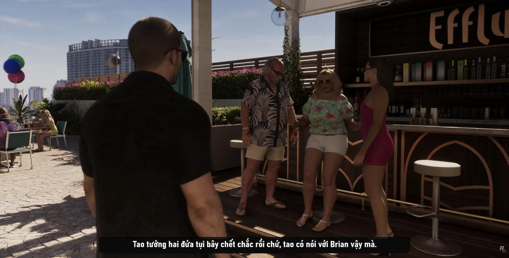
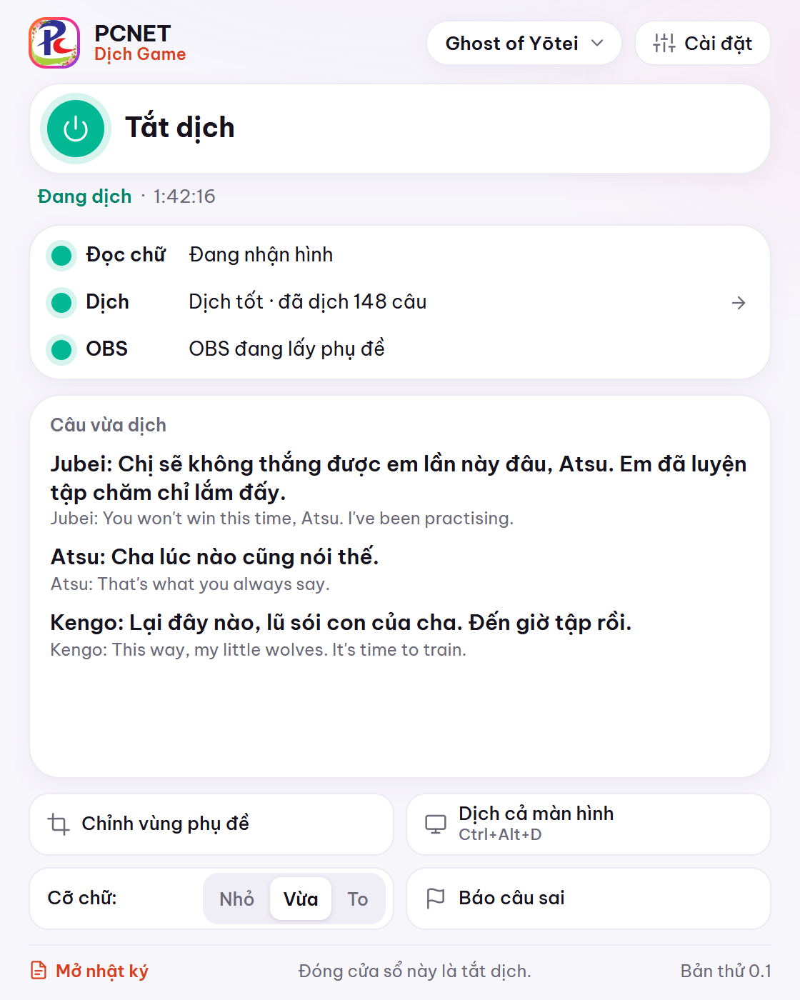

  

<h1 align="center">PCNET Dịch Game</h1>

  <b>Dịch game PS5 và game online trên PC sang tiếng Việt</b> 
  Đọc chữ trên màn hình rồi hiện tiếng Việt đè ngay lên chữ gốc, lúc mình đang chơi.

  
  
  

  <a href="https://www.youtube.com/@pcnetdl">YouTube</a> ·
  <a href="https://www.tiktok.com/@pcnetdl">TikTok</a> ·
  <a href="https://pcnetdl.com">pcnetdl.com</a> ·
  <a href="https://pcnetdl.com/donate">Donate ủng hộ</a>

Phụ đề tiếng Việt hiện trực tiếp trên livestream trailer GTA 6 (bản chạy thử).

> 🚧 **Phần mềm đang chạy thử, chưa phát hành.** Link tải nào lúc này cũng là giả. Có bản cài là mình đăng tại đây và trên [pcnetdl.com/dich-game](https://pcnetdl.com/dich-game/). Bấm **Watch** hoặc **Star** ở góc trên để không lỡ.
>
> **Bản chính miễn phí, ai bán là lừa.**

## Vì sao có phần mềm này

Mình hay livestream game, chơi đủ thể loại. Khổ nỗi game hay thì gần như không có tiếng Việt, mà tiếng Anh của mình lại dở. Nên lâu nay mình toàn đi tìm bản Việt hóa để patch vào chơi.

Nhưng game online và game PS5 thì gần như không có bản Việt hóa, nhất là PS5, muốn patch cũng không được. Mà GTA 6 lúc ra mắt lại chỉ có trên console.

Đó là lý do mình làm phần mềm này. Nó đọc chữ trên màn hình rồi hiện tiếng Việt đè lên chữ gốc, ngay lúc đang chơi, không cần chờ ai Việt hóa. Trước mắt là game PS5, sau này sẽ tới các game online trên PC.

Muốn bản dịch nhanh, chuẩn và chỉn chu thì một mình mình làm không xuể, mình rất cần anh em cộng đồng game thủ góp tay. Vì vậy phần mềm được làm miễn phí và mã nguồn mở: ai cũng dùng được, và ai cũng có thể góp một phần, từ anh em chơi game tới anh em trong các nhóm Việt hóa.

## Phần mềm làm được gì

- **Phụ đề Việt ngay lúc chơi:** chữ Việt hiện đúng chỗ phụ đề gốc.
- **Dịch cả màn hình bằng một phím:** menu, nhiệm vụ, hướng dẫn, bấm **Ctrl+Alt+D** là ra.
- **Xưng hô đúng vai:** cha – con, chị – em không lẫn lộn. Tên nhân vật, địa danh dịch thống nhất.
- **Câu gặp rồi hiện ngay:** lần sau gặp lại không phải chờ.
- **Hiện phụ đề cho người xem live:** gắn thẳng vào OBS.
- **Chỉnh vùng phụ đề, cỡ chữ** cho hợp từng game.
- **Thấy câu sai, bấm một nút là báo.**

 

## Góp sức thế nào

- Cứ chơi và để nguyên ô **"Chia sẻ bản dịch cho người chơi sau"**. Câu nào bạn đã dịch thì người chơi sau gặp lại sẽ hiện ngay, chuẩn hơn.
- Thấy câu dịch sai thì báo cho mình (trong phần mềm có sẵn nút **Báo câu sai**).
- Góp tên nhân vật, địa danh, thuật ngữ cho từng game để máy dịch đúng.
- Ai biết lập trình thì vào góp code.

Bản dịch bây giờ chưa hoàn hảo, nhưng càng nhiều anh em dùng thì càng chuẩn. Mong anh em dùng thử, góp ý và chia sẻ để cùng nhau làm ra phần mềm dịch game hoàn chỉnh nhất cho người Việt.

## Lộ trình

- [x] Chạy thử trên livestream: trailer GTA 6 và game Ghost of Yōtei (PS5)
- [ ] Video demo đầy đủ
- [ ] Đăng mã nguồn và bản cài (chưa chốt ngày)
- [ ] Dịch game online trên PC

## Theo dõi và ủng hộ

- 📺 YouTube: [@pcnetdl](https://www.youtube.com/@pcnetdl) · TikTok: [@pcnetdl](https://www.tiktok.com/@pcnetdl)
- 🌐 Tin game: [pcnetdl.com](https://pcnetdl.com)
- 💝 Donate ủng hộ: [pcnetdl.com/donate](https://pcnetdl.com/donate)

Cảm ơn anh em rất nhiều! ❤️
